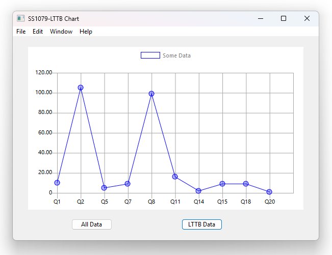

# Xojo-Speed-Charts-Using-LTTB-Downsampling
When building Data Acquisition (DAQ) applications, it is incredibly easy to overload a user interface with too much data. If you try to feed thousands—or millions—of raw data points directly into a Xojo DesktopChart or WebChart control, you will quickly hit a performance wall. This is where the Largest Triangle Three Buckets (LTTB) downsampling algorithm is used. 

Below is a screen grab of the running program created in Windows 11 with Xojo 2026 r2.1, and should work with all desktop system, such as Raspberry Pi and Mac. 

